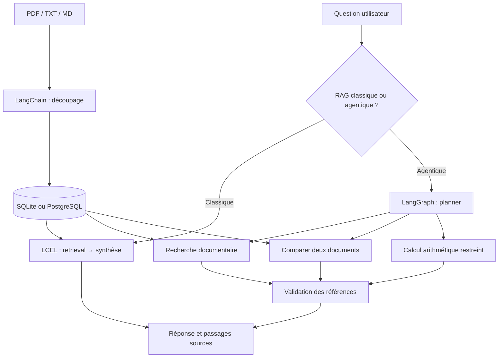

# AfriDoc Intelligence RAG

**Question-réponse sur documents | RAG classique → RAG agentique | LangChain · LangGraph · FastAPI · Python · Docker · PostgreSQL | Cloud et serveur privé**

[Architecture](docs/ARCHITECTURE.md) · [Installation en entreprise](docs/ON_PREMISE.md) · [Sécurité](docs/SECURITY.md) · [Azure](docs/CLOUD_AZURE.md) · [AWS](docs/CLOUD_AWS.md) · [Scénarios de démonstration](docs/DEMO_CHECKLIST.md)

## 1. Pourquoi cette solution ?

Dans une organisation, les réponses à une même question se trouvent souvent dans plusieurs PDF, manuels, procédures ou archives. Les fichiers peuvent être dispersés, les versions se contredire et les collaborateurs perdre du temps à rechercher une information vérifiable. Un assistant généraliste peut produire une réponse convaincante mais non justifiée par les documents de l'utilisateur.

**AfriDoc Intelligence RAG** propose une approche différente : l'utilisateur interroge **ses propres documents** et reçoit une réponse assortie des **passages qui la justifient**, avec un mode de recherche simple et un mode agentique pour les tâches multi-étapes. L'objectif n'est pas de remplacer l'expertise humaine, mais de rendre la connaissance documentaire plus accessible, vérifiable et réutilisable.

**Pour un particulier :** interroger les conditions d'un contrat, retrouver une information dans ses notices, guides ou dossiers personnels, vérifier une date ou comparer deux versions d'un document. Les données peuvent rester sur son ordinateur, sans API LLM externe (mode extractif). L'utilisateur reste responsable de la vérification des éléments juridiques, médicaux ou financiers.

**Pour une entreprise :** accéder plus rapidement aux procédures internes, FAQ, guides RH, documents de conformité, notes d'exploitation et archives métier ; standardiser la recherche d'information ; préparer des comparaisons de versions ; préserver la traçabilité des sources et envisager un assistant documentaire connecté à une infrastructure appartenant à l'entreprise.

**Contexte africain et francophone :** démonstrations sur les coopératives agricoles, l'accès au financement, les frais mobile money et les documents administratifs. Les exemples sont **fictifs**, en français et avec des montants en FCFA ; aucun fichier réel de client n'est inclus.

> **Périmètre réel :** référence technique exécutable et testable, conçue pour des corpus modestes. Ce n'est pas encore un portail documentaire multi-utilisateur prêt à traiter des documents sensibles en production. Les droits d'accès par document, le SSO, l'OCR des scans et les garanties métier sont à développer avant une mise en production à grande échelle.

## 2. Ce que fait l'application

| Capacité | Détails |
|---|---|
| Import documentaire | PDF contenant du texte, TXT et Markdown (jusqu'à 5 Mo par import) |
| RAG classique | Segmentation, recherche TF-IDF + n-grammes, embeddings multilingues facultatifs, synthèse ancrée dans des extraits |
| RAG agentique | Routage borné entre recherche, comparaison explicite de deux documents et calcul arithmétique sécurisé |
| Citations | Identifiants `[S1]`, `[S2]`, fichiers, extraits et scores de recherche exposés dans l'API |
| Transparence | Étapes d'exécution `steps`, validation des identifiants de références, recherche sans résultat explicite |
| Interfaces | API FastAPI + OpenAPI Swagger (`/docs`) et interface Web (`/`) |
| Inference | Mode local sans LLM, Groq facultatif ou serveur de modèle privé OpenAI-compatible (ex. Ollama) |
| Déploiement | Docker Compose, PostgreSQL sur serveur privé, guides Azure Container Apps et AWS App Runner |

## 3. Comment LangChain et LangGraph interviennent

**LangChain** est utilisé pour le découpage des documents (`RecursiveCharacterTextSplitter`, package `langchain-text-splitters`) et la chaîne RAG classique LCEL (`RunnableLambda`, package `langchain-core`). Ces composants conservent une logique de traitement lisible, testable et interchangeable.

**LangGraph** prend en charge le mode agentique : un `StateGraph` porte l'état d'une question, un nœud `planner` choisit une route autorisée, puis la recherche/la comparaison/le calcul s'exécute avant la synthèse et la validation des références. **Il n'y a ni accès libre à un terminal ni action arbitraire sur les fichiers.** La sélection peut être déterministe ou assistée par un LLM, toujours limitée à trois capacités.



Le RAG classique est volontairement conservé : il est plus simple, prévisible et souvent suffisant. Le mode agentique est pertinent lorsqu'une question exige plusieurs outils ou une comparaison, mais n'améliore pas automatiquement la justesse du contenu.

## 4. Démarrage local (Python)

Prérequis : **Python 3.11+** et Git. Installation des bibliothèques de base, y compris LangChain/LangGraph :

```bash
git clone <URL_DE_VOTRE_DEPOT>
cd afridoc-intelligence-rag
python -m venv .venv
source .venv/bin/activate                 # Windows : .\.venv\Scripts\Activate.ps1
python -m pip install -e ".[dev]"
cp .env.example .env                     # Windows : Copy-Item .env.example .env
# Remplacer APP_API_KEY par une valeur aléatoire longue.
python scripts/seed_demo.py
uvicorn app.api:app --env-file .env --host 127.0.0.1 --port 8000
```

Interface : `http://127.0.0.1:8000/` · Swagger : `http://127.0.0.1:8000/docs`.

Sans clé de modèle, le moteur présente les passages source. Pour une réponse reformulée, sélectionner un fournisseur dans `.env` :

```dotenv
LLM_PROVIDER=off                       # aucun appel LLM, recherche extractive
# OU
LLM_PROVIDER=groq                      # renseigner GROQ_API_KEY
# OU
LLM_PROVIDER=local                     # LLM privé sur réseau interne
LOCAL_LLM_BASE_URL=http://127.0.0.1:11434/v1
LOCAL_LLM_MODEL=qwen2.5:3b
```

Le modèle local ne fait **pas** partie de ce dépôt : il doit être installé et approuvé séparément (Ollama ou serveur compatible). Les résultats varient selon le modèle, les documents et le matériel.

### Exemple API

```bash
export KEY="<VOTRE_APP_API_KEY>"
curl -X POST http://127.0.0.1:8000/v1/documents/upload \
  -H "X-API-Key: $KEY" -F "file=@examples/guide-cooperatives-2025.txt"

curl -X POST http://127.0.0.1:8000/v1/query \
  -H "X-API-Key: $KEY" -H "Content-Type: application/json" \
  -d '{"question":"Quel est le délai de traitement des demandes ?"}'

curl -X POST http://127.0.0.1:8000/v1/agent/query \
  -H "X-API-Key: $KEY" -H "Content-Type: application/json" \
  -d '{"question":"Compare les conditions de 2025 et 2026", "source_a":"guide-cooperatives-2025.txt", "source_b":"guide-cooperatives-2026.txt"}'
```

Importer d'abord les deux guides pour utiliser la comparaison. Les réponses restent bornées aux documents présents.

### Docker local

```bash
cp .env.example .env
# Renseigner APP_API_KEY dans .env.
docker compose up --build -d
```

L'API n'écoute par défaut que sur le port loopback `127.0.0.1:8000` de l'hôte. Le mode de stockage Docker local utilise un volume SQLite ; une entreprise doit préférer PostgreSQL et une architecture de sécurité dédiée.

## 5. Déploiement sur le serveur de l'entreprise

**Oui.** Le projet peut être exécuté sur un VPS, un serveur Linux interne, une machine virtuelle de l'entreprise ou un hôte Docker dans son réseau privé. Il n'exige pas Azure ou AWS. Un exemple `compose.enterprise.yaml` inclut **PostgreSQL**, l'API et un serveur **Ollama facultatif**, sans publier le port PostgreSQL ni celui d'Ollama. Le port de l'API reste limité au loopback et doit être desservi par un reverse proxy HTTPS avec authentification.

```bash
cp .env.enterprise.example .env.enterprise
# Renseigner APP_API_KEY, POSTGRES_PASSWORD et le même mot de passe dans DATABASE_URL.
# Mode 1 : sans LLM externe ni local (extraits sourcés)
docker compose --env-file .env.enterprise -f compose.enterprise.yaml up -d --build

# Mode 2 : modèle interne (adapter LLM_PROVIDER=local dans .env.enterprise)
docker compose --env-file .env.enterprise -f compose.enterprise.yaml --profile local-llm up -d --build
docker compose --env-file .env.enterprise -f compose.enterprise.yaml exec ollama ollama pull qwen2.5:3b
```

La récupération initiale d'un modèle exige généralement un accès Internet, mais l'inférence peut ensuite se faire en interne si l'infrastructure est isolée et correctement administrée. **Attention :** héberger les données sur son serveur ne garantit pas à lui seul leur confidentialité ; il faut configurer les droits, la sauvegarde, le chiffrement, les journaux et la sortie réseau. Suivre le [guide pas-à-pas dédié](docs/ON_PREMISE.md).

## 6. Mesures, tests et limites

```bash
pytest -q
python scripts/evaluate.py
```

Le script d'évaluation mesure le Hit@3 sur **quatre questions fictives**, sans prétendre évaluer une utilisation réelle. Les tests vérifient notamment l'authentification, la recherche sourcée, la comparaison et les calculs. Les capacités d'inférence locale doivent être validées avec un modèle réellement démarré, puis évaluées sur des documents de l'entreprise.

**Limites :** TF-IDF reconstruit à la requête (petits corpus), aucun OCR des PDF image, aucun cloisonnement par utilisateur/document, pas de SSO, pas de moteur vectoriel persistant, citations validées seulement au niveau des identifiants, pas de garantie de véracité. Avant exploitation sensible : RBAC/SSO, pgvector ou autre index durable, chiffrement, audit, sauvegardes testées, tests d'injection et validation juridique/réglementaire.

## 7. Stack technique

`Python` · `FastAPI` · `LangChain Core (LCEL)` · `LangChain Text Splitters` · `LangGraph StateGraph` · `SQLAlchemy` · `PostgreSQL / SQLite` · `scikit-learn / TF-IDF` · `Sentence Transformers (optionnel)` · `Groq / Ollama (optionnels)` · `Docker Compose` · `Pytest` · `GitHub Actions` · `Azure Container Apps` · `AWS App Runner`.

**English summary:** A document-grounded, French-first classic and agentic RAG reference architecture for individuals and enterprises. LangChain powers retrieval-chain composition and document splitting; LangGraph orchestrates a bounded search/compare/calculation graph. Runs locally, in a private enterprise deployment or in the cloud, with optional hosted/private LLM inference. Not a production-ready multi-tenant document-security product.

## Licence

MIT — voir [LICENSE](LICENSE).
