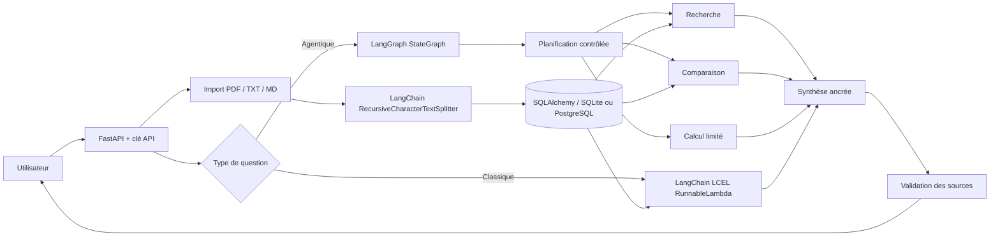

# Architecture — AfriDoc Intelligence RAG v2

**LangChain** : segmentation via `langchain-text-splitters`, construction et exécution LCEL via `langchain-core.runnables`. **LangGraph** : `StateGraph`, nœud planificateur, branches conditionnelles (`search`, `compare`, `calculate`), synthèse et contrôle de citations. Le code d'orchestration se trouve dans `app/agent_graph.py`; l'API reste compatible avec la V1.

## Ce qui est implémenté

- Documents texte en base SQL, segments de taille plafonnée et dédoublonnage par contenu.
- Recherche de proximité lexicale TF-IDF + n-grammes caractères ; embeddings multilingues facultatifs via Sentence Transformers.
- Réponse extractive hors LLM ou génération via Groq, voire serveur local compatible OpenAI.
- Vérification que les identifiants `[S#]` cités par le LLM existent dans les résultats, sans prétendre contrôler toute la véracité.
- Traces de routage et outils exposées par l'API, outil `calculate` avec AST restreint.

## Ce qui n'est pas implémenté

Le graphe n'a pas de mémoire/checkpointer persistante ni de recherche Web. Il ne peut pas effectuer d'opérations d'administration, ni d'action libre. Pas d'OCR pour scans, d'ACL, de SSO, d'audit nominatif ou d'index vectoriel partagé persistant. Les documents et extraits importés doivent être considérés comme potentiellement malveillants ou confidentiels.

Le déploiement serveur privé est détaillé dans [ON_PREMISE.md](ON_PREMISE.md). Les besoins de GPU/modèle et les performances de recherche sur de grands corpus restent à mesurer.
